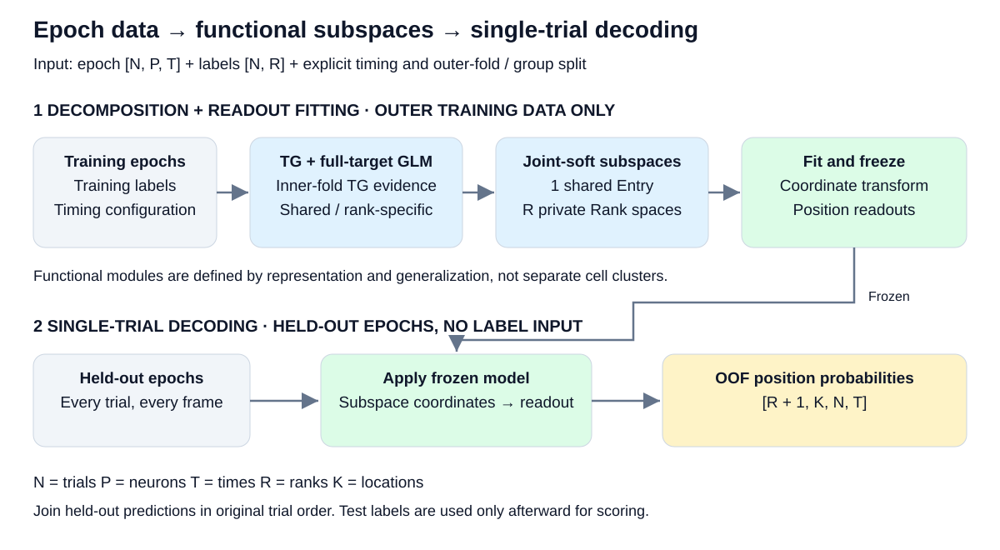
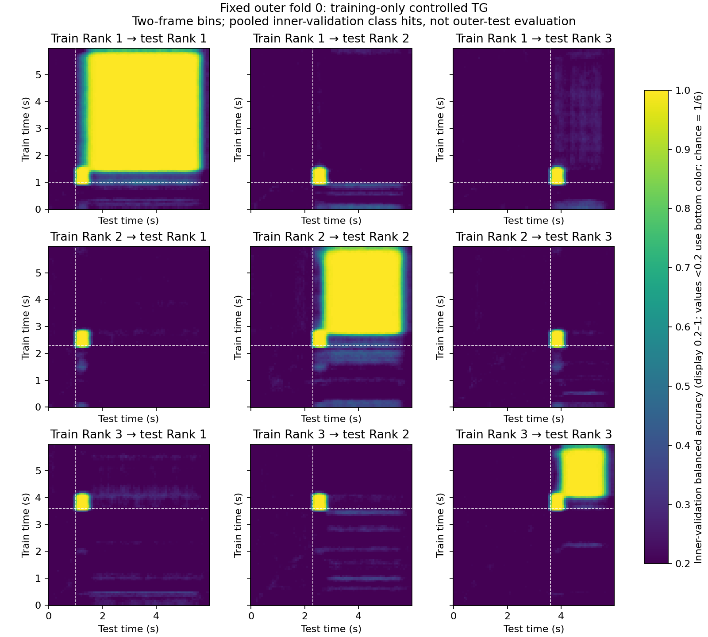
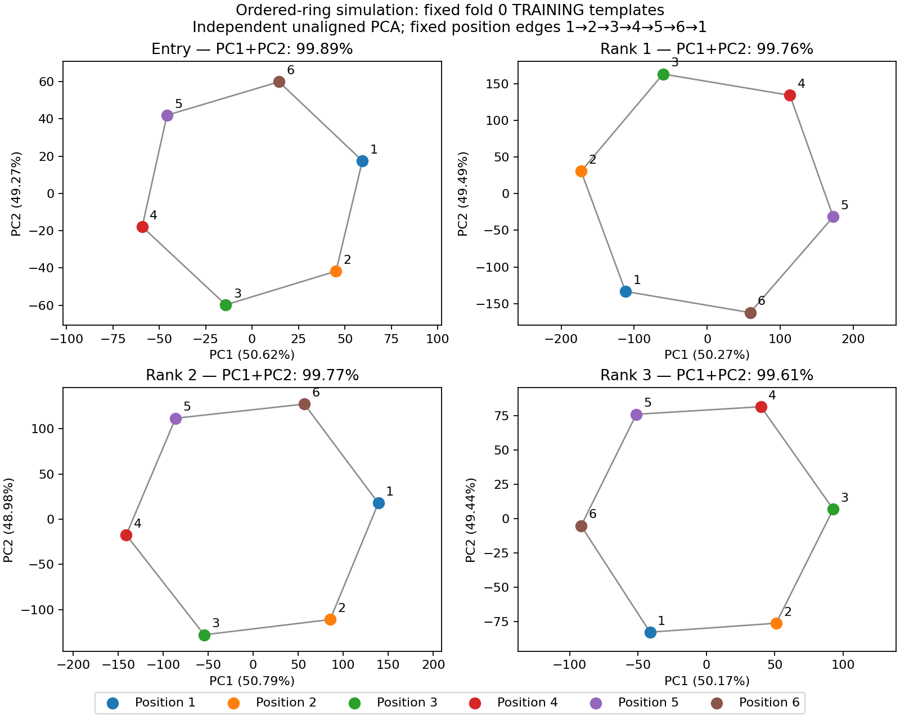
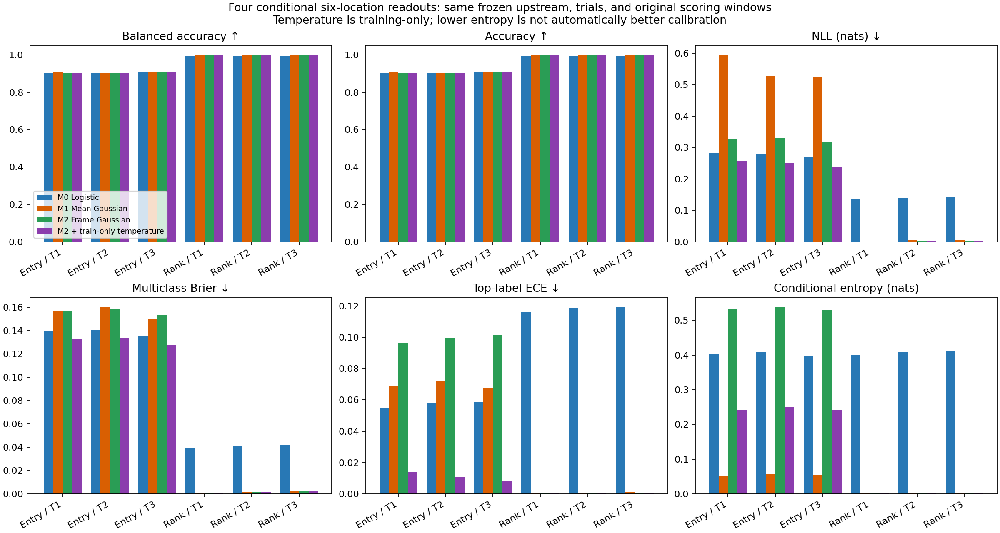
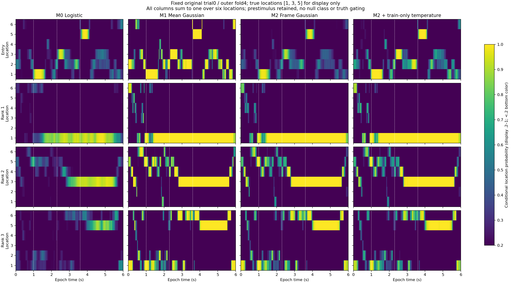

# Entry–Rank Subspaces & Single-Trial Probabilistic Decoding

**Author / 作者：Hao Zhou**

**一个完全合成数据的可复现教程：从群体神经活动中估计跨 rank 共享与 rank-specific 功能子空间，再逐 trial、逐帧读出位置概率。**

A reproducible **synthetic-data tutorial** for shared/Rank-specific subspace estimation and single-trial location decoding. This is not an analysis of empirical neural recordings or evidence for a particular brain mechanism.

```text
epochs [n_trials, n_neurons, n_times] + labels [n_trials, n_ranks]
  → training-only controlled temporal generalization (TG)
  → one cross-rank shared Entry space + n_ranks Rank spaces
  → frozen readouts
  → probabilities [n_ranks + 1, n_locations, n_trials, n_times]
```



## 1. 模拟与功能子空间 / Simulation and subspaces

当前例子为 **600 trials × 60 neurons × 180 frames**，3 ranks、6 locations；输出 `4 × 6 × 600 × 180`。六个位置以固定 `cos/sin` 一阶谐波生成，四个真实源彼此正交；Entry 短暂出现，Rank 持续。持续时间是**生成假设**，不是 Entry/Rank 的定义。空间依训练内跨 rank TG 关系联合估计，不是独立 PCA 或互斥时间 gate。




真模板 rank=2，但 GLM 和学习空间保留完整 `K−1` 维及实际数值 rank=5，**不截两维做 decoding**。各 PCA 轴独立、未对齐；二维图不是 held-out 神经轨迹。夹角和方向性模板 VAF 使用完整空间，另有 leading-2 诊断，不能将其称为可加独占信息。

**[模拟配置、完整几何、TG、源恢复与结果](single-trial-decoding-demo/ordered-ring/README.md)** · [数学约定](single-trial-decoding-demo/docs/METHODS.md)

## 2. 四种固定上游的概率读出 / Matched readouts

同一数据、外折、预处理、TG、子空间与坐标，只比较读出：

|版本|估计方式|
|---|---|
|M0 Logistic|窗口均值训练的 multinomial logistic|
|M1 Gaussian Bayes|窗口均值的类均值与共享 shrinkage covariance；显式 uniform prior|
|M2 Frame Gaussian|仅在原训练窗口内匹配逐帧 likelihood；不扩展训练时段|
|M2 + T|在 outer-training 内做 whole-trial readout cross-fit，拟合每空间一个温度|

Gaussian 版本是 **plug-in Bayesian class posterior**，不是全参数 Bayesian 模型。温度校准的 inner readout 验证固定上游，不是重新嵌套拟合整套表示；outer-test 不参与训练或温度选择。正温度保持 M2 的 argmax 不变，也可以小于 1、使概率更尖。




本模拟的 Entry NLL 从原 Gaussian 的 `.595/.528/.523` 改为 M2+T 的 `.257/.251/.237`；logistic 为 `.282/.280/.269`。改善主要是概率评分，不是准确率的普遍提升；Rank 温度收益不一致。完整报告保留 NLL、Brier、BA、ECE、entropy 和整 trial 配对区间，不把相关帧或五个 folds 当独立实验。

**[最新方法、完整指标、复现和限制](single-trial-decoding-demo/bayesian-optimized/README.md)** · [M0–M1 基础比较](single-trial-decoding-demo/bayesian-readout/README.md)

### 概率的解释边界 / Interpretation limits

- 六位置概率以**六个互斥类别**为条件，不是“有没有内容”的概率；uniform 不等于 absence，尖峰不证明真实或想象内容，也不能识别多位置同时共激活。
- 全部刺激前帧保留，不使用 null 类别或真 gain gate 删除信号。M3 baseline-like null 仅是模拟假设失败反例：其 q95 阈值在后续弱 gain 时段有约 48–59% 假警报；M4 协议间隔负例模型未运行。
- 概率校准、entropy 与活动强度都不等于动物主观信心。时间平滑包含约未来 0.1 秒信息；此示例不支持精确提前编码推断。
- 高 BA 不保证语义源完全分离。固定 trial 0 仅作展示，不能由单个 trial 判定残留信号来源。

## 3. 神经 variance 与标签预测 / Reconstruction versus prediction


所有读出共享上游，故**神经重构 R²/VAF 相同**。从同一留出输入 X 提取坐标再重构 X，不是预测独立或未来神经响应；投影还保留测试噪声。单 block 与 drop-block ΔR² 不是可相加的 unique variance。NLL、环形位置误差和神经 VAF 属于不同层级。

**[定义、数值和可复现诊断](single-trial-decoding-demo/model-comparison/README.md)**

## 快速复现 / Reproduce

从仓库根目录执行；输出目录需尚不存在。大型 NPZ 缓存不随仓库发布，由命令生成。

```bash
cd single-trial-decoding-demo
pip install -e '.[test]'
python ordered-ring/run_ordered_ring.py --output ordered-ring/runs/new-ring --threads 1
python ordered-ring/plot_ordered_ring.py --run ordered-ring/runs/new-ring --output ordered-ring/figures/new-ring
python bayesian-readout/run_comparison.py --source ordered-ring/runs/new-ring --output bayesian-readout/results/new-comparison
python bayesian-optimized/run_calibrated.py --source ordered-ring/runs/new-ring --baseline bayesian-readout/results/new-comparison --output bayesian-optimized/results/new-calibrated
python model-comparison/compare_models.py --source ordered-ring/runs/new-ring --comparison bayesian-readout/results/new-comparison --output model-comparison/results/new-metrics
python -m pytest -q ../tests tests ordered-ring/test_ordered_ring.py bayesian-readout bayesian-optimized model-comparison
```

保存报告的 provenance 中，历史源码标识记录的是产生该报告时的版本，并不要求 checkout 该历史 commit。上述复现命令直接使用本仓库当前文件，无需其它仓库；核心数值推断保持不变，完整模型与概率 NPZ 在本地重新生成。

[数组 API、时间配置及输入校验](single-trial-decoding-demo/README.md)。所有预测接口不接收测试标签；标签仅用于训练与事后评分。This tutorial uses synthetic data only, preserves held-out evaluation, and makes no claims about calibrated content presence or simultaneous-location identification.

## 方法参考 / References

以下为使用的标准估计器官方文档，不代表对本教程完整方法或神经科学结论的验证。网页会更新；实际运行依赖版本以随结果保存的 provenance 为准。

- [scikit-learn: LedoitWolf](https://scikit-learn.org/stable/modules/generated/sklearn.covariance.LedoitWolf.html) — Gaussian 读出的共享协方差 shrinkage 估计。
- [scikit-learn: LogisticRegression](https://scikit-learn.org/stable/modules/generated/sklearn.linear_model.LogisticRegression.html) — 基线多类 logistic 读出的实现与参数说明。

## License

尚未指定许可证 / **No license has been designated.**
