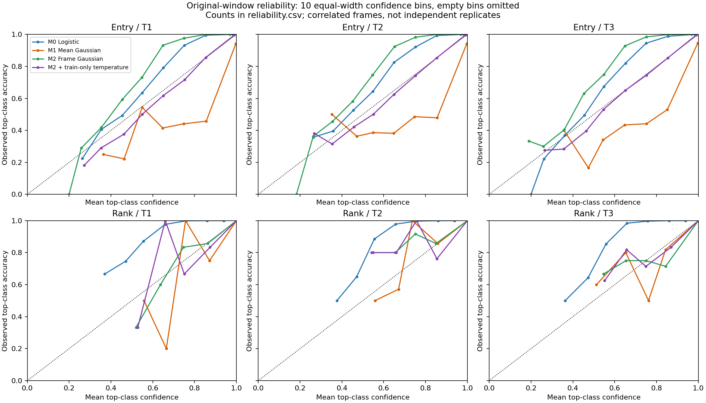
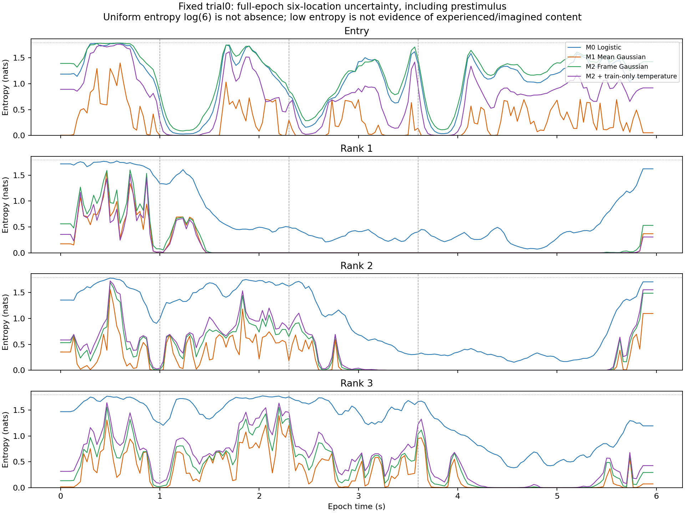
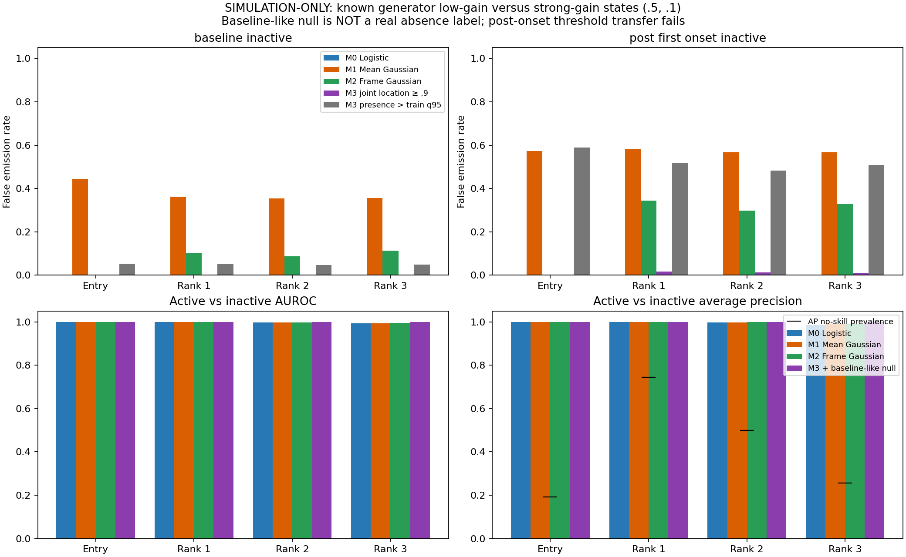

# 优化 Bayesian readout：匹配逐帧噪声，再训练内校准

**刺激前也可能有想象内容，不能自动当作“没有内容”。** 本目录主方法保留每个trial、每个时点（包括刺激前）的六位置概率；没有baseline-null类别，没有基于时间、刺激onset或生成器gain的预测gate。

## 主线：四个可归因的读出版本

上游ordered-ring数据、外折、train-only预处理、TG、子空间、joint coordinates和latent scaler全部冻结：

1. **M0 Logistic**：原multinomial readout。
2. **M1 原Gaussian Bayes**：原window-mean训练样本估计类均值/within-class共享LW协方差，逐帧预测。
3. **M2 逐帧噪声匹配**：只在原训练读出窗内，用每个训练trial的逐帧坐标估计Gaussian类均值/共享LW协方差。训练trial/rank/class/frame权重均衡；位置类别均值与M1数值等价，主要改变协方差。没有增加测试trial或扩训练时间窗。
4. **M2+T 训练内温度校准**：`p_k=softmax(log p_M2,k / T)`；每个outer fold×component只有一个正T，所有时点共同使用，不调类别prior或时间gate。

温度仅用outer-training中其余4个既有fold的whole-trial readout-only cross-fit预测拟合：Entry三个原窗等权汇总，Rank自己的late窗。优化预声明范围`T∈[.05,20]`的logT，最小化训练内NLL；若数值失败或比T=1更差，按预声明规则回退1并记录。**inner验证时upstream/scaler固定且已见这些outer-training样本，所以不是完整嵌套representation验证**；最终outer-test完全未参与fit/校准/温度选择。

T>0严格保持argmax及BA不变。T可小于1而变尖，不是一律把概率压平。此run Entry T=.447–.463：逐帧匹配先变得较保守，校准再适度变尖；Rank T=.550–1.363，不能以“总是更软”描述优化。

## 原六个窗口上的实际OOF结果

每帧先计算NLL/Brier等再汇总，仍是原六个预定义Entry/own-Rank窗；没有用真gain挑选最漂亮的active帧作为主结果。NLL越低越好；ECE为10个固定等宽top-label confidence bins的描述性估计。

|窗口|Logistic NLL|原Bayes NLL|逐帧匹配 NLL|逐帧＋温度 NLL|逐帧＋温度 ECE|
|---|---:|---:|---:|---:|---:|
|Entry / T1|0.2817|0.5946|0.3281|0.2571|0.0139|
|Entry / T2|0.2799|0.5278|0.3290|0.2506|0.0106|
|Entry / T3|0.2689|0.5234|0.3176|0.2374|0.0083|
|Rank / T1|0.1365|0.0012|0.0012|0.0013|0.0001|
|Rank / T2|0.1399|0.0050|0.0034|0.0034|0.0005|
|Rank / T3|0.1419|0.0055|0.0039|0.0039|0.0004|




**主要改善是概率评分，不是准确率奇迹。** Entry的M2+T NLL/ECE明显改善，当前NLL也低于logistic；但BA仍是M2的.9013/.9008/.9061，低于原Bayes的.9094/.9040/.9099。Rank的温度收益不一致，T1/T3 NLL略变差；不宣称每个指标每个空间均胜出。主方法没有根据outer-test选温度/seed，完整[指标和M2+T−M2配对trial-bootstrap区间](results/ordered_ring_frame_temperature_v1/metrics.json)保留失败和小差异。

bootstrap1000次、seed2026、同一整trial重采样用于六窗；只条件于本模拟和冻结OOF模型，不代表重训或跨动物不确定性，无显著性星号。校准在这些训练窗拟合，不保证其它时间/真实任务分布同样校准。

## Single trial：不删除刺激前表征




固定原trial0、fold4；真标签1/3/5只用于展示，预测不接收它们。所有四列都是完整六位置分布，逐时刻和为1，统一色标.2–1（低于.2底色；数组不裁剪），所有刺激前帧保留。优化后仍可出现其它时点的峰，不能直接判为“本不该有信号”。

### 六位置posterior能告诉我们什么，不能告诉什么？

它是**在这六个互斥位置类别假设下的条件概率**，不是“有没有内容”的概率。uniform仅表示这些位置在当前模型下缺少可辨识差异；不能区分：没有内容、六位置等强共激活、或跨trial均衡但每个single trial仍有选择性。

当前理想化cos/sin中心化环的六位置向量之和为0，等强线性叠加可以抵消，形成真正的可识别性限制；不能凭零均值/低位置差异断言无内容，也不能凭活动强度断言同时想象六个位置。实际数据可能还有公共模式、非线性或其它编码，本demo未建立其模型。

保存的Gaussian参数可计算likelihood/预测密度作为分布失配诊断，但密度依赖坐标单位与假设，仍不能证明共同内容或真实absence。校准概率、entropy与神经活动强度都不等于猴的主观信心。

## 仅模拟反例附录：为什么不推荐baseline-null当默认方法

模拟反例 M3 定义为：用训练baseline拟合一个baseline-like Gaussian，与M2的六个位置likelihood竞争，假设alternative prior=.5。它输出7joint（baseline-like +6位置）及模型假设下的alternative mass。**这不是已验证的真实有/无内容概率，不作为主推荐，也不用于删除刺激前解码。** 没有运行进一步的协议间隔负例模型M4，因为间隔也不自动代表无内部内容。

这项只针对已知生成器的诊断使用真gain事后定义strong≥.5峰、weak≤.1峰，其他灰区排除；真gain先经过同输入的baseline/SG处理，绝不进入fit/阈值。两组预声明敏感性(.25,.05)、(.75,.15)全部保存，不择优。baseline阈值由readout-only cross-fit的q95选择，strict `score>q95`。

|空间|post-stim低gain假警报率（q95）|strong-active TPR（同阈值）|正确位置报告/所有active|
|---|---:|---:|---:|
|Entry|58.9%|100.0%|99.96%|
|Rank 1|51.9%|100.0%|99.93%|
|Rank 2|48.2%|100.0%|99.85%|
|Rank 3|50.9%|100.0%|99.71%|

**q95阈值迁移失败：post-stim弱gain帧约48–59%仍越过阈值。** 同阈值TPR100%，不是靠永远不报告来得到低假警报。Entry阈值约.043–.054，Rank约6e−8–3e−7；很小的模型alternative mass也会超过tiny q95，所以“越过q95”不等于posterior>.5。AUROC几乎1也不保证操作点或概率校准成功。



baseline参与每trial自身baseline subtraction，会使该窗噪声比后续时段更小；其它成分活动也会改变分布。这是可能的失配机制，并未用单独实验排除所有原因。M3把joint位置≥.9的伪高峰压低不等于识别了真实absence；该事件与六位置条件最大概率≥.9、q95 detection是三种不同指标，不能偷换。

[反例全部指标、TPR/FPR、binary Brier/NLL、ROC/AP与sensitivity](results/simulation_only_baseline_null_v3/summary.json)，[原窗口对照](results/simulation_only_baseline_null_v3/original_window_metrics.csv)。这些“active/inactive”是模拟生成条件而不是实际想象的标签；不能迁移为真实数据监督真值。

## 复现主方法

在`single-trial-decoding-demo/`下，先按[原Bayesian比较](../bayesian-readout/README.md)生成完整ring及原两方法缓存：

```bash
python bayesian-optimized/run_calibrated.py \
  --source ordered-ring/runs/new-ring \
  --baseline bayesian-readout/results/new-comparison \
  --output bayesian-optimized/results/new-calibrated
python -m pytest -q bayesian-optimized
```

`--reference-m2`仅可选验证已有M2完整NPZ，不用于fit；本次重放最大logp差4.3e−14。主入口不读取ground-truth、不构造null或absence标签。大型数组/折模型NPZ由命令重建，compact报告保留[源码/输入/环境/20个温度与优化状态](results/ordered_ring_frame_temperature_v1/provenance.json)。

只有明确要复现**模拟假设反例**时，才单独运行`run_optimized.py --source ... --baseline ... --output ...`；它不是实际数据默认方案。所有输出目录禁止覆盖。该附录不改变主线的六位置条件解码；所有方法共用同一冻结上游。

附录发布的是compact summary：保留所有scalar指标/操作点/敏感性，仅省去ROC/PR和coverage曲线的采样坐标（图已保留）。`run_optimized.py`重建完整metrics.json；`compact_diagnostic_report.py`仅作这种无数值修改的打包。
