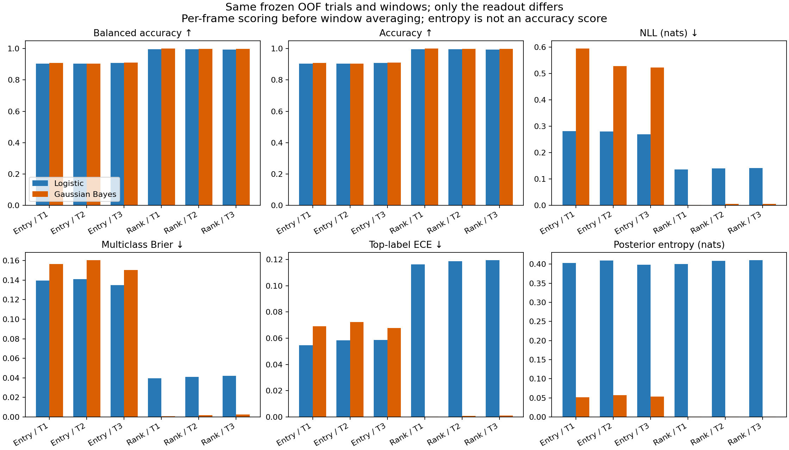
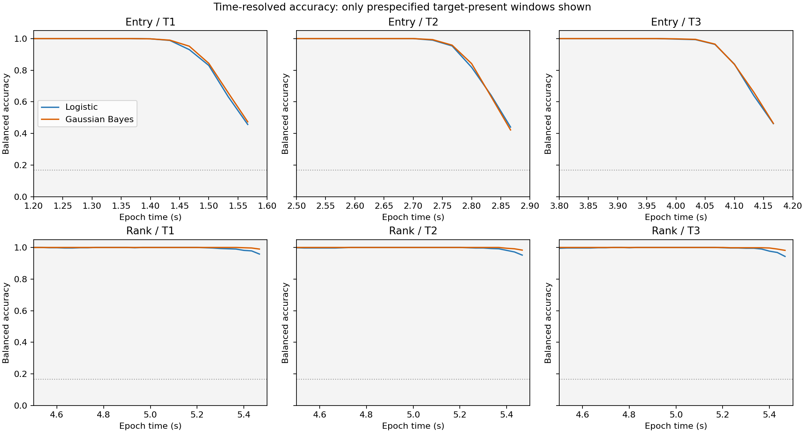
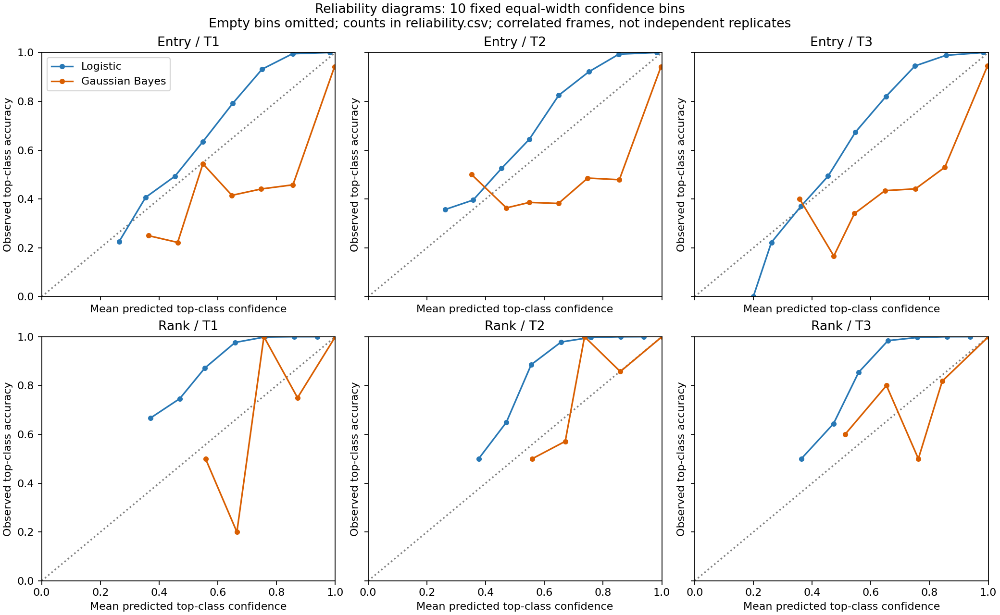
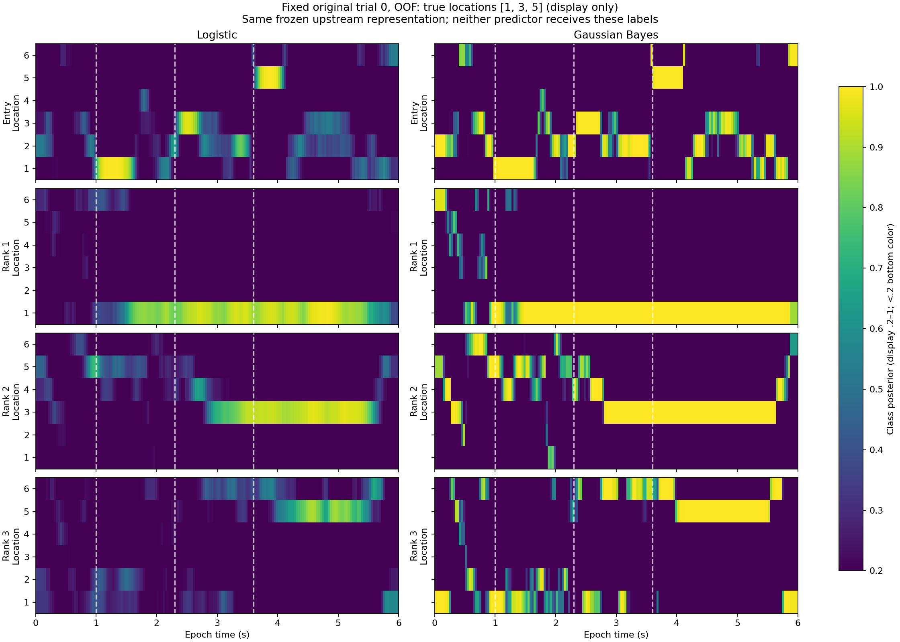
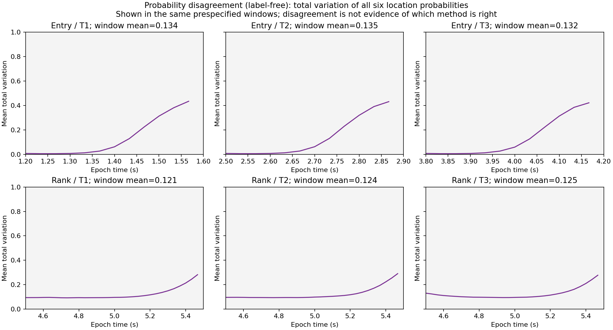

# Bayesian probabilistic decoding：只替换 readout 的配对比较

当前 ordered-ring 模拟与现有 logistic JSPD 读出保持**相同数据、外折、训练内预处理、TG、联合子空间、joint coordinates、训练窗口与样本权重**。只将冻结的多类 logistic readout 替换为 Gaussian plug-in Bayesian class posterior。不是把整套子空间模型变成全参数 Bayesian 模型。

## 概率模型与训练

对每个 component 的训练样本 z，估计六个类别均值 μ_k 和共享协方差 Σ：

`p(k|z) = exp(log N(z; μ_k, Σ) + log π_k − logsumexp_l(log N(z; μ_l, Σ) + log π_l))`

- 显式均匀位置先验 π_k=1/6；位置顺序仍为1..6。可测试其它先验，但当前比较无先验调优。
- **训练样本是每 trial 在原读出窗口的平均 joint coordinate**，不是任意增加逐帧训练样本。Entry堆叠3个目标窗；各Rank只用其own late窗。
- 复用 logistic 的同一个 training-only latent StandardScaler。所有外训练折、rank、类别均为80 trials，现有权重全部相等；实现assert并记录，不支持的非均匀权重会明确报错而非悄悄忽略。
- 在去除各类均值后的 pooled within-class residual 上估计 `LedoitWolf(assume_centered=True)` 共享协方差，不把between-class差异混进噪声。无test calibration、调参或新seed选择。
- 用Cholesky whitening及logsumexp稳定计算。协方差特征值数值下限为`1e-8 × max(mean eigenvalue,1)`；当前20个读出均未触发。零维/完全无类别差异的观测返回显式先验。
- μ、Σ为点估计；只对类别用Bayes公式归一，**不积分参数不确定性、不宣称概率已校准**。

一个重要限制：两方法都用window mean训练、对single frame预测。Gaussian估计的是window-mean条件协方差，并非真实逐帧噪声协方差；外推可能造成过尖后验。为保持训练样本一致，本比较没有偷偷改用逐帧训练、时间依赖likelihood/gain或temperature calibration。

共享Σ时，二次项`zᵀΣ⁻¹z`在类别归一化中抵消，因此该模型也是**线性softmax/LDA形式**：`score_k=zᵀΣ⁻¹μ_k−0.5μ_kᵀΣ⁻¹μ_k+logπ_k`。与logistic的主要区别是生成式与判别式参数估计、正则化及概率尺度，不是logistic“没有概率”。本比较不证明脑采用Bayesian计算。window-mean→frame失配是可能解释，未以单独实验排除其他分布/正则化因素，不能当作已识别的因果原因。

## 完整 OOF 定量结果

每trial恰好留出一次。分数先对每帧计算，再在预定义有目标的窗口内平均；不是先平均概率再评分。所有6类均衡，因此当前BA和accuracy相同，但二者均保存。NLL与entropy单位为nat；Brier为六类平方误差之和（0..2）。ECE采用10个固定等宽top-label confidence bins；相关帧仅用于描述，不当独立样本。

|窗口|Logistic BA|Bayes BA|Logistic NLL|Bayes NLL|Logistic Brier|Bayes Brier|Logistic ECE|Bayes ECE|
|---|---:|---:|---:|---:|---:|---:|---:|---:|
|Entry / T1|0.9029|0.9094|0.2817|0.5946|0.1397|0.1565|0.0546|0.0692|
|Entry / T2|0.9036|0.9040|0.2799|0.5278|0.1408|0.1603|0.0583|0.0722|
|Entry / T3|0.9076|0.9099|0.2689|0.5234|0.1350|0.1504|0.0586|0.0679|
|Rank / T1|0.9958|0.9995|0.1365|0.0012|0.0396|0.0007|0.1163|0.0003|
|Rank / T2|0.9954|0.9990|0.1399|0.0050|0.0409|0.0018|0.1188|0.0007|
|Rank / T3|0.9946|0.9987|0.1419|0.0055|0.0422|0.0024|0.1194|0.0010|

**没有全面胜者。** 当前Entry窗的Gaussian BA略高，但NLL、Brier与ECE全部更差：后验更尖，却在错误时承担更大损失。当前Rank晚窗Gaussian的分类与概率评分均更好，logistic相对保守。这个差别属于此固定模拟、共享Gaussian分布假设和window-mean→frame外推；不能据此断言Bayesian普遍优于logistic，也不能只凭低entropy等同更准或猴的主观信心。





可靠性图只画有样本的bins；bin counts/accuracy/confidence见[reliability.csv](results/ordered_ring_matched_readouts_v1/reliability.csv)。ECE是有限样本分箱估计，不是校准保证。

## 同一个 trial 的差异

固定原trial0（outer fold4，真实位置1/3/5），不选好看的trial。每个方法均对全部原180帧输出`[4,6,600,180]`概率；图色标0.2–1，低于.2用底色，数组不裁剪。展示标签不传入predict。




概率差异为total variation=`0.5×sum_k|p_B−p_L|`，JS divergence也完整保存；两者均与真实标签无关，不证明哪种方法对。无目标时段仍可输出概率，Gaussian也可能呈现没有真实目标支撑的过尖后验；不把它当作有效记忆内容或可靠置信度，也不将该时段accuracy/NLL当成有意义的目标读出成绩。

## 配对不确定性与审计

[metrics.json](results/ordered_ring_matched_readouts_v1/metrics.json)记录各指标及Bayes−Logistic的95% percentile bootstrap区间：1000次、固定seed2026，**按whole trial联合重采样所有目标/帧/方法**；同一draw矩阵用于六个窗口。这里只条件于这次模拟和已冻结OOF预测，不涵盖重训、跨动物或跨实验不确定性，也不做多重比较显著性声明。负NLL/Brier差值较好，正BA差值较好。

[provenance.json](results/ordered_ring_matched_readouts_v1/provenance.json)保存输入、全部冻结模型与源码SHA，训练样本数、权重、LW shrinkage、最小特征值、当前依赖版本。五折logistic原预测逐一重放误差0；运行前后上游文件hash不变。大型完整概率和模型NPZ不提交，命令可重建。

## 复现

在 `single-trial-decoding-demo/` 下（输出目录必须不存在）：

```bash
pip install -e '.[test]'
# 若没有完整原缓存，先重建唯一当前ring模拟；不改变任何推断参数
python ordered-ring/run_ordered_ring.py --output ordered-ring/runs/new-ring --threads 1
python bayesian-readout/run_comparison.py --source ordered-ring/runs/new-ring --output bayesian-readout/results/new-comparison
python -m pytest -q tests ordered-ring/test_ordered_ring.py bayesian-readout
```

使用现有完整cache时，将`--source`指向它即可，无须重训TG/子空间。新方法模块独立放在本目录；原joint-soft核心和logistic读出均未修改。拟合函数只接收训练数组；预测函数无labels参数。未来若改成不均衡设计，需要另行明确支持加权协方差，不能直接忽略训练权重。

## 进一步模型比较

[共同神经表示重构R²/VAF、环形误差与uniform基线评分](../model-comparison/README.md)：神经VAF对两方法相同；只在标签读出层比较差异，不把同X重构称独立神经预测。

## 后续概率优化

[逐帧匹配和训练内温度校准](../bayesian-optimized/README.md)保留本页原Bayes作为ablation baseline；不删除刺激前解码、不把baseline当无内容。
