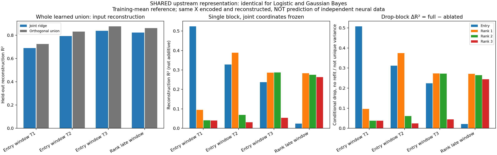
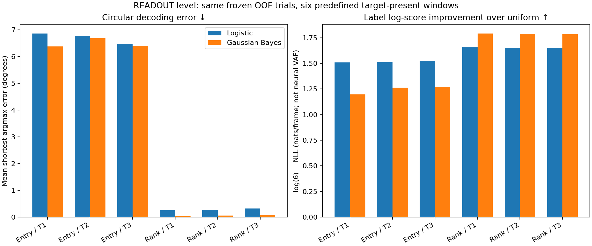

# 模型比较：解释了哪一种 variance？

**本页数值表比较 M0 logistic 与 M1 window-mean Gaussian；它们只替换readout，使用完全相同的神经子空间与坐标。所以神经层VAF/R²必须相同，不能凭这个指标选logistic或Bayesian赢家。** 本目录把神经表示层和位置读出层分开，避免把“分类更准确”称为“解释更多神经方差”。

|指标|比较层级|能否区分当前两个readout？|
|---|---|---|
|held-out input reconstruction R²|共同神经表示的重构能力|不能；上游相同|
|正交union能量VAF|同一学习空间能捕获多少输入能量|不能；上游相同|
|单block / drop-block ΔR²|固定joint coordinates的重构分配|不能；不是可加独占贡献|
|NLL、Brier、ECE、BA|位置标签概率/分类|能，见Bayesian比较|
|环形角误差|最可能位置偏离真实位置多远|能，利用1..6的固定环结构|
|相对uniform的log-score gain|概率给正确位置的对数评分改善|能，但不是neural VAF/互信息|

本结论也适用于[逐帧 likelihood 与温度校准扩展](../bayesian-optimized/README.md)：它们同样固定上游，因此不会改变这里的神经重构。下方环形误差与标签 log-score 数值专指 M0–M1，不是优化版本的成绩。

## 共同神经表示的held-out重构

固定四个唯一窗口：三个Entry窗[1.2,1.6)、[2.5,2.9)、[3.8,4.2)，以及共同Rank晚窗[4.5,5.5)。每个outer fold仅用外训练trial估计：

1. 先沿用原训练baseline center/scale得到标准化神经数据Z。
2. `μ_w = mean(Z_train)`，仅对该窗的训练trial×frame平均，不按labels分组。
3. 对留出数据 `W=Z_test−μ_w`，固定原joint-coordinate映射A和拼接basis Q，重构 `Zhat=μ_w+W A Qᵀ`。
4. `R²=1−sum_folds SSE / sum_folds SST`，其中 `SST=sum||Z_test−μ_w||²`。**先池化SSE/SST再计算比值，不平均fold R²。负值不截断。**

窗口均值同时是诊断intercept与reference；这个重新中心化只用于预先定义的几何诊断，不改动原decoder前向计算。输入X本身同时用于提取坐标和重构X，所以这是**外训练固定表示对held-out输入的重构**，不是预测独立/未来神经响应。没有将测试神经元、测试trial或未来真实标签拿去重新拟合。

|窗口|Joint ridge重构R²|Orthogonal union能量VAF|
|---|---:|---:|
|Entry T1|0.6901|0.7257|
|Entry T2|0.7947|0.8325|
|Entry T3|0.8391|0.8779|
|Rank late|0.8239|0.8621|



正交union基准把同一个训练Q用SVD正交化为U，重构`μ_w+W U Uᵀ`。所有折union数值秩20，每个component数值秩5。此正交重构的R²等于中心化输入被投影捕获的能量比例；与实际带coordinate ridge的operational重构不同，不是重新拟合一个更好的decoder。

**这些是观测到的标准化神经输入的能量，包括投影保留的测试噪声，不是signal-only解释率。** 增大投影维度通常提高这类VAF；不能据此断言机制更正确。真实生成模板总信号维度与估计空间数值维度不同，不能偷换为同一概念。

- `Only j`：只保留第j个joint-coordinate block重构，其他block置零；不是单独对该空间重新做最优投影。
- `Drop j`：从full reconstruction减去该block，**不重拟合A**。
- `ΔR²_j=R²_full−R²_drop_j`：固定其余block时删去该block的影响，可以为负。各block重构向量可相加，但**R²/ΔR²不能相加成unique variance分解**，因为平方误差有交叉项、空间有重叠且坐标有正则化。

当前Entry重构贡献在输入窗明显、晚窗小；已出现的Rank成分在后续窗持续。这是该生成模型及估计表示的诊断，不是新decoder带来的优势。[完整fold SSE/SST与定义](results/ordered_ring_frozen_v1/metrics.json)、[重构表](results/ordered_ring_frozen_v1/neural_reconstruction.csv)、[drop-block表](results/ordered_ring_frozen_v1/drop_block_delta.csv)。

## 读出层：环形误差和相对uniform评分

只在原来的六个有目标窗口评分，每帧先评分再平均：

- 环形角误差：argmax位置与真实位置的最短圆周距离，`60°×min(|k−y|,6−|k−y|)`。越小越好，范围0–180°，没有重排类别。
- log-score gain：`log(6)−NLL`（nat/frame），相对显式均匀位置基线，越大越好，可为负。它是已报告NLL换一个基线表达，**不是新的独立证据、neural explained variance、互信息、Bayes factor或参数模型证据**。



Entry环形误差：logistic为6.86/6.78/6.48°，Gaussian Bayes为6.38/6.68/6.40°；Gaussian分类位置稍接近，但其Entry log-score gain仅1.197–1.268 nat，对比logistic1.510–1.523 nat更差，仍反映过尖错误的代价。Rank晚窗Gaussian角误差0.03/0.06/0.08°，对比logistic0.25/0.28/0.33°；log-score也更好。[完整读出表](results/ordered_ring_frozen_v1/readout_scores.csv)。

因此“哪个模型解释variance更多”的回答分两层：**这两个readout共享同一神经表示，神经重构一样；对标签的概率预测则没有全面赢家，Entry概率质量logistic较好、Rank晚窗Gaussian较好。** 不能把环形误差小或后验尖称为更高神经VAF或猴的主观信心。

没有添加posterior-weighted模板重构或跨不同likelihood的AIC/BIC。若要比较真正独立的神经预测，需要另设未用于解码输入的神经响应/时间/重复试验，并重新设计训练与验证，不能从当前缓存的同X重构得到。

## 复现与验证

在`single-trial-decoding-demo/`中，先按[Bayesian比较](../bayesian-readout/README.md)重建完整ring/两方法概率缓存，再执行：

```bash
python model-comparison/compare_models.py \
  --source ordered-ring/runs/new-ring \
  --comparison bayesian-readout/results/new-comparison \
  --output model-comparison/results/new-metrics
python -m pytest -q model-comparison
```

输出目录不覆盖；[metrics.json](results/ordered_ring_frozen_v1/metrics.json)保存输入/模型SHA及脚本SHA。只做诊断，没有重训或改动原子空间、读出器和数据。所有负值按实际保留，图不造两方法VAF差异。
