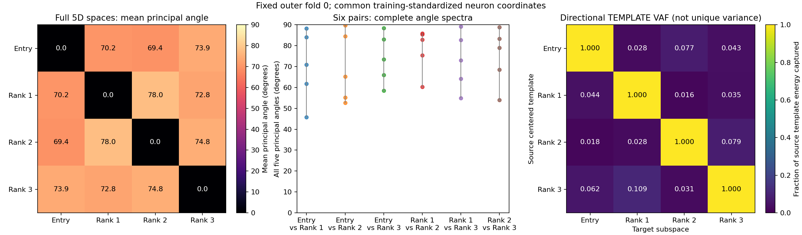
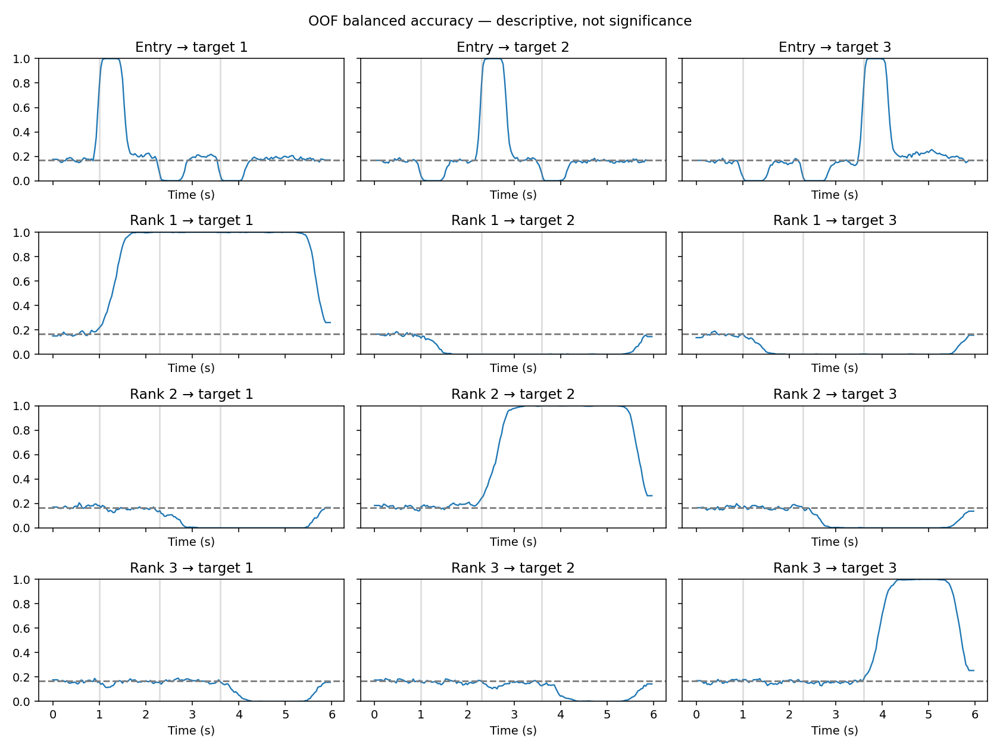
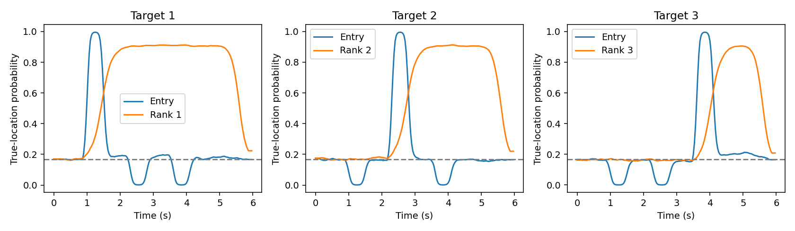
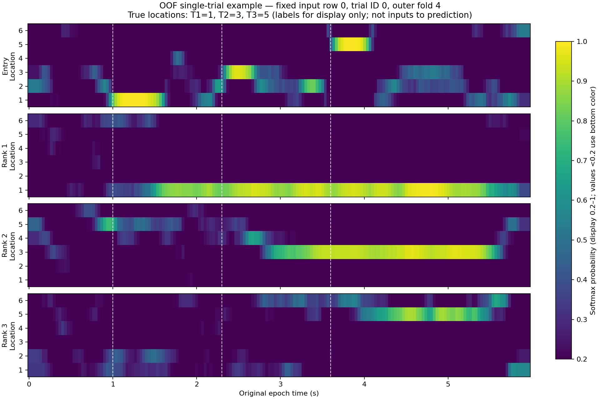
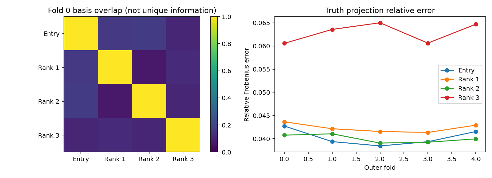

# 当前模拟：有序环形位置编码 + 短暂跨 rank 共享信号

本教程采用以下合成生成模型。六个位置类别的生成编码为 `cos(2πk/6), sin(2πk/6)`，编号 1→2→3→4→5→6→1；四个真实源彼此正交（rho=0），共享 Entry 随每次输入短暂出现，Rank 源持续。时间持续性是此生成设定，不是 Entry/Rank 的定义。算法仍以训练内 TG 的跨 rank 关系定义功能模块，a/b 可以同时非零。

**只改变生成模型，不改变 joint-soft 推断、GLM 或冻结 readout。** 真值 rank=2，估计模板仍是完整数值 rank=5；没有强制截维、重排类别、吸附圆环。PCA2 仅用于显示，完整 5D 夹角/VAF 与 leading-2 诊断分别报告。本模拟不构成实测神经数据环形结构的验证。

## 当前完整运行

600 trials × 60 neurons × 180 frames；3 ranks、6 locations；5 外折 × 4 内折。所有图来自同一次实际运行。固定 outer fold 0 展示 TG/模板几何；固定原 trial 0（外折 4）展示 OOF 概率，不挑 trial。

- [运行配置与指标](runs/ordered_ring_transient_shared_r3/report.json)、[推断配置](runs/ordered_ring_transient_shared_r3/config.json)、[生成配置](runs/ordered_ring_transient_shared_r3/simulation_config.json)、[源码与环境](runs/ordered_ring_transient_shared_r3/provenance.json)
- [TG / PCA / 完整空间及 leading-2 指标定义](figures/ordered_ring_transient_shared_r3/metrics.json)
- [跨目标与源归因诊断](audit/ordered_ring_transient_shared_r3/diagnostics.json)

Entry 窗 BA 为 .9029/.9036/.9076，Rank 晚窗为 .9958/.9954/.9946。fold 0 PCA2 保留 99.89%/99.76%/99.77%/99.61%；20 个折×空间均保留循环邻接。这是生成模型的恢复结果，不是一般数据保证。

跨 rank TG 的 early→early / early→late / late→early / late→late 块均值为 .8121/.1913/.1366/.1604，within-rank late→late=.9975；chance=1/6，仅作描述，不声称每格等于 chance。两个热图显示范围为 .2–1，低于 .2 使用底色，原始数值不裁剪。




各 PCA 坐标独立，跨图方向不可比较。VAF 是源模板在目标空间内的能量比例，非原始 epoch 方差、非独占或可加贡献。低能噪声方向仍计入完整 5D 角度；leading-2 结果不是替换后的解码空间。






单个 trial 可有残留或错误位置概率；不能仅凭该图区分模板混合、readout 偏置与噪声。高 BA 不证明语义源被完全分离。真值只有 2 维，额外估计方向应结合匹配角度、维数与投影残差阅读。

## 复现

在 `single-trial-decoding-demo/` 中执行（`new-ring` 必须尚不存在）：

```bash
pip install -e '.[test]'
python ordered-ring/run_ordered_ring.py --output ordered-ring/runs/new-ring --threads 1
python ordered-ring/plot_ordered_ring.py --run ordered-ring/runs/new-ring --output ordered-ring/figures/new-ring
python examples/plot_single_trial.py --oof ordered-ring/runs/new-ring/oof.npz --output ordered-ring/runs/new-ring/single_trial_0.png
python scripts/audit_saved_run.py --run ordered-ring/runs/new-ring --out ordered-ring/audit/new-ring
python -m pytest tests ordered-ring/test_ordered_ring.py
```

完整 OOF 数组及折模型由上述命令重建，不提交大型 NPZ。所有图均来自同一固定生成配置的实际运行，描述性结果不代表跨数据集保证。另见[概率读出比较](../bayesian-optimized/README.md)和[共同表示重构诊断](../model-comparison/README.md)。
